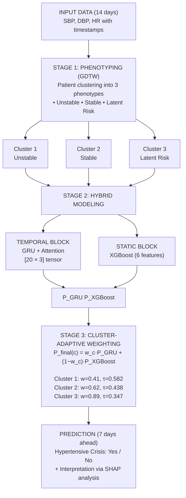

# Cluster-Adaptive Hybrid GRU-XGBoost Architecture for Predicting Hypertensive Crises

## Table of Contents

1. [Project Overview](#project-overview)
2. [Scientific Problem](#scientific-problem)
3. [Data](#data)
4. [EDA and Preprocessing](#eda-and-preprocessing)
5. [Methodology](#methodology)
6. [Model Architecture](#model-architecture)
7. [Results](#results)
8. [Interpretability](#interpretability)
9. [Project Structure](#project-structure)
10. [Installation and Running](#installation-and-running)
11. [ClusterBP v2](#clusterbp-v2)

---

## Project Overview

> **Note on versions.** Sections 1–8 below describe the first version of ClusterBP (v1). Its evaluation used a balanced test set, a random window split, no gap between history and horizon, and phenotypes computed from each patient's full history. The leakage audit in [ClusterBP v2](#clusterbp-v2) shows that these choices inflate the metrics, so the v1 numbers (e.g. Macro F1 0.858) are not comparable with v2. Current results are in the [ClusterBP v2](#clusterbp-v2) section.


**ClusterBP** is a cluster-adaptive hybrid architecture for predicting hypertensive crises based on remote blood pressure (BP) monitoring data. The system is validated on the largest real-world remote monitoring cohort: **11,739 patients** and **4.9 million BP measurements** from 19 Russian regions as part of the national "Personal Medical Assistants" (PMP) program.

The project addresses three key limitations of existing prediction systems:
1. **Small cohorts** — uses a real national program with broad phenotypic diversity.
2. **Fixed thresholds** — instead of a single SBP > 140 mm Hg threshold, personalized prediction is used.
3. **Lack of interpretability** — SHAP analysis ensures transparency of predictions for physicians.

---

## Scientific Problem

Hypertensive crises are life-threatening cardiovascular events whose precursors accumulate silently in BP dynamics days before clinical manifestation. The problem is formulated as binary classification:

> **Using BP data over 14 days (SBP, DBP, HR with timestamps), predict whether a hypertensive crisis will occur in the next 7 days.**

The system delivers interpretable one-week risk alerts, enabling proactive physician intervention before crisis onset.

---

## Data

### Data Sources

The analysis uses anonymized data from the federal pilot project "Personal Medical Assistants" (PMP), collected from November 2023 to December 2024 across 119 medical organizations in 19 constituent entities of the Russian Federation.

### Data Structure

| File | Description | Key Fields |
|------|-------------|------------|
| `Идентификаторы Субъектов 10.04.2025.csv` | Reference of RF regions | region id, region name |
| `Идентификаторы МО 15.04.2025.csv` | Reference of medical organizations | MO id, MO name |
| `МО и Пациенты 10.04.2025.csv` | Patient-program linkage | patient id, observation group, MO id |
| `Первичные данные от 10.04.2025.csv` | BP measurements | SBP, DBP, HR, height, weight, date/time, patient id |
| `Медикаментозная терапия от 10.04.2025.csv` | Prescribed therapy | patient id, INN, prescription date |
| `Клинически значимые события от 15.04.2025.csv` | Crisis events | patient id, event code, date |

### Final Cohort

| Parameter | Value |
|-----------|-------|
| Patients (analytical cohort) | 11,739 (19 regions, 119 MOs) |
| Primary BP measurements | 4,888,853 |
| Clinical event records | 1,243,036 |
| Pharmacotherapy records | 23,798 |
| Average measurements / patient | 673 |

### Crisis Event Codes (Positive Class)

- **33901** — crisis, unspecified
- **33900** — hypertensive crisis
- **33012** — hypertensive encephalopathy
- **33601** — hypertensive retinopathy
- **33801** — acute BP elevation

Proportion of positive examples in time window data: **41%**.

---

## EDA and Preprocessing

### Preprocessing Pipeline

1. **Deduplication and Outlier Removal**
   - Removed 78,000 duplicate records (same patient, same second)
   - Excluded 435 records with physiologically impossible values:
     - SBP ∉ [40; 250] mm Hg
     - DBP ∉ [30; 150] mm Hg
     - HR ∉ [30; 220] bpm

2. **Timezone Correction**
   - Measurements from five time zones converted to patient's local time
   - Without correction, 42.9% of measurements appeared as nighttime
   - After correction, nighttime readings reduced to 14% (consistent with expected behavior)
   - Morning (06:00-10:00) and evening (18:00-22:00) measurement peaks restored

3. **Missing Value Imputation**
   - Height and weight (missing for 45% of patients) — filled with stratum medians (observation group × age decile)
   - Diagnosis codes (missing for 60% of patients) — marked as "Not specified"
   - New features created: **BMI** and **pulse pressure**

4. **Patient Exclusion**
   - 361 patients excluded based on criteria:
     - BMI > 50 kg/m² (n = 23)
     - Fewer than three measurements in any 14-day window (n = 338)

### Target Variables

Three types of target variables created for ML tasks:

| Variable | Type | Description |
|----------|------|-------------|
| `target_high_risk` | Binary | 1 — if number of CSEs above median |
| `target_risk_category` | Multiclass | Low, Medium, High, Very High risk |
| Regression | Continuous | Absolute number of CSEs |

---

## Methodology

### Stage 1: Patient Phenotyping via GDTW

**GDTW (Generalized Dynamic Time Warping)** — a modified DTW algorithm incorporating temporal penalty:

> **Alignment Cost = (Value Difference)² + γ × (Temporal Shift / Window)²**

**Clustering Parameters:**
- Time window: **14 days** (maximum allowed shift)
- Gamma (γ): **1.0** (temporal penalty weight)
- Primary indicator: **SBP** (most clinically significant)

**7,389 patients** with continuous observation ≥ 30 days were selected for clustering. **~27.3 million pairs** of distances were computed using JIT compilation (Numba) for acceleration.

**Number of Clusters Selection:**
- Silhouette coefficient: maximum at k=2 (0.330)
- Elbow method: inflection at k=3
- **Final choice: k = 3** (clinically optimal compromise)

**Three Phenotypes:**

| Cluster | Size | Mean CSEs | Characteristics |
|:---|:---:|:---:|:---|
| **Cluster 1 — "Unstable"** | 815 | **242.9** | High crisis frequency, absence of dominant pattern, heterogeneous structure |
| **Cluster 2 — "Stable"** | 4,200 | **109.3** | Minimal event frequency, negative SBP trends (effective therapy) |
| **Cluster 3 — "Latent Risk"** | 2,374 | **171.1** | Intermediate frequency, positive SBP trends despite few complications — "hidden threat" |

**Statistical Validation:**
- One-way ANOVA of SBP trend: **F = 14.538, p < 0.0001**
- Pairwise t-tests with Bonferroni correction (adjusted α = 0.0167)

### Stage 2: Hybrid Modeling

**Features divided into two orthogonal blocks:**

| Block | Model | Features |
|-------|-------|----------|
| **Temporal** | GRU with soft-attention | Tensor [20 × 3]: 20 most recent measurements (SBP, DBP, HR) |
| **Static** | XGBoost | 6 scalar features: mean SBP, std SBP, TIR, age, BMI, cluster |

**GRU Architecture:**
```
BatchNormalization → GRU(64, dropout=0.20) → Soft Attention → GlobalAveragePooling1D → Dense(1, sigmoid)
```

**XGBoost Architecture:**
- 500 trees
- max_depth = 5
- learning_rate = 0.05
- scale_pos_weight = inverse class frequency ratio

### Stage 3: Cluster-Adaptive Weighting

Final probability:
> **P_final(c) = w_c · P_GRU + (1 − w_c) · P_XGBoost**

where c ∈ {1, 2, 3} is the patient's cluster, w_c is the cluster-specific GRU weight, and binary decision is made at threshold τ_c.

**Optimal Parameters (averaged across 5 folds):**

| Cluster | GRU Weight (w_c) | Threshold (τ_c) | Clinical Interpretation |
|:---|:---:|:---:|:---|
| 1 — Unstable | 0.41 | 0.582 | Equal contribution; noise limits GRU |
| 2 — Stable | 0.62 | 0.438 | GRU captures predictable dynamics |
| 3 — Latent Risk | 0.89 | 0.347 | GRU dominates; cyclicity is key signal |

**Important:** Hyperparameters (w_c, τ_c) were optimized strictly within the cross-validation loop with patient-level splitting to prevent data leakage.

---

## Model Architecture



---

## Results

### Five-Fold Cross-Validation (Macro F1, patient-level splitting)

| Fold | ClusterBP (ours) | Simple Ensemble | GRU only | XGBoost only |
|:---:|:---:|:---:|:---:|:---:|
| 1 | 0.8722 | 0.8531 | 0.8544 | 0.8260 |
| 2 | 0.8667 | 0.8477 | 0.8433 | 0.8431 |
| 3 | 0.8516 | 0.8395 | 0.8368 | 0.8350 |
| 4 | 0.8526 | 0.8360 | 0.8359 | 0.8227 |
| 5 | 0.8457 | 0.8270 | 0.8293 | 0.8073 |
| **Mean ± SD** | **0.858 ± 0.011** | 0.841 ± 0.010 | 0.840 ± 0.009 | 0.827 ± 0.014 |

### Performance Gain

| Comparison | ΔMacro F1 |
|-----------|:---:|
| ClusterBP vs Simple Ensemble | **+0.017** |
| ClusterBP vs GRU only | **+0.018** |
| ClusterBP vs XGBoost only | **+0.031** |
| ClusterBP vs Threshold classifier (SBP > 140) | **+0.34** (abs. p.) |

### Statistical Significance

| Comparison | t-test | Wilcoxon |
|-----------|:---:|:---:|
| ClusterBP vs Simple Ensemble | 0.0002 | 0.0625 |
| ClusterBP vs GRU only | 0.0003 | 0.0625 |
| ClusterBP vs XGBoost only | 0.0041 | 0.0625 |

### Final Results on Independent Test Set

| Class | Precision | Recall | F1-score |
|-------|:---:|:---:|:---:|
| Stable (negative) | 0.83 | 0.83 | 0.83 |
| Hypertensive crisis (positive) | 0.87 | 0.87 | 0.87 |
| **Macro average** | **0.85** | **0.85** | **0.851** |

**95% CI for Macro F1:** [0.843; 0.859] (1000 iterations of percentile bootstrap)

---

## Interpretability

### SHAP Analysis

Global SHAP values show:

| Feature Type | Contribution to Predictive Power |
|--------------|:---:|
| Dynamic trends (SBP and DBP slopes) | ~40% |
| Static aggregates (mean, std SBP) | ~16% |
| Cluster membership | ~8% |

**Key finding:** Dynamic BP trends are **2.5×** more informative than the best static feature.

### Clinical Insights by Cluster

| Cluster | SHAP Interpretation |
|---------|---------------------|
| **Cluster 1 — Unstable** | No single feature dominates → heterogeneous structure → higher XGBoost weight (w₁=0.41) |
| **Cluster 2 — Stable** | Strongly negative SBP trends → predictor of low risk → confirmation of effective therapy |
| **Cluster 3 — Latent Risk** | Positive SBP trends → early warning signal → inaccessible to fixed thresholds |

---

## Project Structure

```
├── Presentations/
│   ├── EDA_presentation.pdf
│   ├── EDA.pdf
│   ├── GDTW_presentation.pdf
│   └── GDTW.pdf
│
└── README.md
```

---

## Installation and Running

### Requirements

- Python 3.11+
- TensorFlow 2.14+
- XGBoost 2.0+
- SHAP 0.44+
- scikit-learn
- pandas, numpy, matplotlib, seaborn
- Numba (for GDTW acceleration)

### Install Dependencies

```bash
pip install tensorflow==2.14.0 xgboost==2.0.0 shap==0.44.0 scikit-learn pandas numpy matplotlib seaborn numba
```

### Run EDA and Preprocessing

```python
# Sequential execution of all processing stages
# (code files should be in the root directory)

python 1_load_and_validate_data.py
python 2_clean_and_preprocess.py
python 3_eda_analysis.py
python 4_impute_missing_values.py
python 5_create_ml_dataset.py
```

### Run GDTW Clustering

```python
python 6_gdtw_clustering.py
```

---

## ClusterBP v2

The second version of the ClusterBP pipeline keeps the architecture (GDTW phenotypes + GRU and XGBoost modules + fusion of their predictions) and extends the task definition, features and evaluation:

* **Two event types** instead of one combined target: **A** — acute BP rise (codes 33012, 33901) and **B** — BP above the patient's target, a sign of ineffective therapy (33601, 33801, 33802, 33911). Code 33902 (heart-rate red zone) is not a BP event, and 33810 ("signs of reaching target BP") is the opposite of B and appears only in some months, causing jumps in the B rate; both are kept only as sensitivity checks (`A_with33902`, `B_with33810`), together with `B_no33601` (33601 exists only from November 2024) and `B_gap0`. The first-version target is kept as **OLD** for comparison. According to the operator's code dictionary, clinically significant events are alerts of the monitoring system (BP and HR "zones", loss of target BP control).
* **Causal setup:** history windows and events share one timeline (server time); a gap of 1 day (A) and 7 days (B) separates the history window from the prediction horizon, so the target is not computed from the input measurements.
* **Extended static module** (XGB_full): peaks and variability of BP (ARV), slopes, shares of readings above 140/160/180 mm Hg, DBP, HR, measurement regime, history of events before the prediction time, and long-history features over the past 30/60/90 days (day-to-day SBP variability, event counts; `LH_COLS` in `clusterbp_lib.py`).
* **Strict evaluation:** patient-level 5-fold CV; early stopping, thresholds and fusion weights tuned on an inner validation split; phenotypes fitted on training patients only and assigned from the past 30 days of each window; metrics at the real event rate; patient-level bootstrap 95% CIs; comparison with clinical rules.
* **Temporal validation:** training before 2024-10-01, testing on October 2024 – January 2025, separately on new patients.
* **Mixture-of-experts comparison:** learnable phenotype gate, MoE gate on patient features (Hurley et al., 2023), residual experts (Lee & Hauskrecht, 2022).
* **Multi-method interpretability** (SHAP, permutation importance, Integrated Gradients, temporal occlusion) with agreement and sanity checks, following Grubov et al., *IJNS* 2026.
* **Additional analyses:** clinical utility (calibration, alert burden, first-episode sensitivity, lead time, decision curves), ablations of phenotypes and per-cluster fusion, choice of k, alternative tabular models (Random Forest, HistGradientBoosting) and sequence models (time-aware GRU, TCN, Transformer), region-held-out validation.
* **Synthetic data** with the same file structure, generated by rules without any training on real data, so the whole pipeline can be run without access to the proprietary export.

### Notebooks

| Notebook | Content | CPU time |
|:---|:---|:---|
| `clusterbp_v2.ipynb` | Cleaning, windows and features, phenotypes, 5-fold CV of all models, bootstrap | ~35 min + ~1 h bootstrap (first run) |
| `clusterbp_v2_temporal.ipynb` | Temporal validation | ~10 min |
| `clusterbp_v2_moe.ipynb` | Mixture-of-experts comparison | ~25 min |
| `clusterbp_v2_interpret.ipynb` | Interpretability: feature groups, channels, occlusion, sanity checks, physiology, case studies | ~6 min |
| `clusterbp_v2_additional.ipynb` | Cohort, confusion matrices, clinical utility, ablations, choice of k, alternative tabular models | ~1 h |
| `clusterbp_v2_regions.ipynb` | Region-held-out validation | ~45 min |
| `clusterbp_v2_sequence_models.ipynb` | Alternative sequence models | ~2 h |

Run `clusterbp_v2.ipynb` first, then `clusterbp_v2_moe.ipynb` before `clusterbp_v2_additional.ipynb` and `clusterbp_v2_regions.ipynb`: the other notebooks reuse its windows, fold models and predictions. Shared code is in `clusterbp_lib.py`, dependencies in `requirements.txt`. The operator's export goes into `2025_04_15/` in the repository root; it is not stored in git, nor are intermediate patient-level files (`cache_v2/`). Quick run on 1,500 patients: `CLUSTERBP_DEBUG=1` (outputs go to `cache_v2_debug/` and `results_v2_debug/`).

### Running on synthetic data

```bash
python synthetic/make_rule_based_data.py --patients 1500          # writes synthetic/rule_based/
export CLUSTERBP_RAW_DIR=synthetic/rule_based CLUSTERBP_TAG=synthetic
jupyter nbconvert --to notebook --execute --output-dir synthetic/run clusterbp_v2.ipynb
```

The generator simulates a blood pressure series for each patient (baseline, trend, day-to-day variation, surge episodes) and assigns clinically significant events by zone rules (e.g. a "red zone" at SBP ≥ 180 mm Hg). With `CLUSTERBP_TAG=synthetic` all intermediate files and results go to `cache_v2_synthetic/` and `results_v2_synthetic/`. Metrics on synthetic data have no clinical meaning; the data only show that the code runs end to end.

### Main results

Cross-validation at the real event rate (A — 3.8% of windows, B — 12.2%):

| Model | A: AUROC | A: AUPRC | B: AUROC | B: AUPRC |
|:---|:---:|:---:|:---:|:---:|
| ClusterBP v2 (GRU + XGB_full) | 0.925 | 0.488 | 0.936 | 0.713 |
| XGB_full | 0.926 | 0.487 | 0.935 | 0.712 |
| ClusterBP v1 (GRU + XGBoost on 6 features) | 0.912 | 0.438 | 0.920 | 0.663 |
| Rule: maximum SBP in the window | 0.892 | 0.312 | 0.787 | 0.352 |

Temporal validation (test from October 2024): ClusterBP v2 reaches AUPRC 0.46 for A and 0.70 for B; 0.33 and 0.63 on new patients. On regions not seen in training, AUPRC is 0.49 for A and 0.71 for B, the same as in patient-level CV. Predicted probabilities are well calibrated (ECE ≤ 0.002). With the earlier code sets (A with 33902, B with 33810) XGB_full reaches AUPRC 0.45 and 0.69; without the gap B would look much better (AUPRC 0.85), which is leakage, not skill.

At the main operating threshold the model mostly anticipates repeated events: it detects 67% of all type A episodes but only 3% of a patient's first episode. This is a threshold effect, not a lack of signal: on windows without any prior event of the type, XGB_full reaches AUPRC 0.076 for A (event rate 0.9%; max-SBP rule 0.038) and 0.167 for B (event rate 2.1%; rule 0.050), and at 95% specificity it detects 41% and 47% of such events (rule 30% and 17%). With a threshold tuned on these windows, it flags 24% (A) and 33% (B) of first events about 5 and 12 days ahead, at 0.03 and 0.08 alerts per patient-week; the max-SBP rule flags 28% (A) and 15% (B) but at 0.08 and 0.09 alerts per patient-week (`results_v2/first_events/`).

Leakage audit (`results_v2/leakage/`, XGB_full): a balanced 1:1 test inflates AUPRC by 0.44 (A) and 0.22 (B); a random window split by 0.10 and 0.07; omitting the gap by 0.06 and 0.14; fitting phenotypes on all patients or on the full history changes AUPRC by ≤ 0.01; tuning the threshold on test changes Macro F1 by ≤ 0.002. All errors together give AUPRC 0.96 (A) and 0.97 (B) instead of 0.49 and 0.71, and shrink the model's lead over the max-SBP rule from 0.18 to 0.06 (A) and from 0.36 to 0.18 (B).

Long-history features (30–90 days) add 0.012 AUPRC for both A and B; therapy features add nothing (only 0.3% of patients had a new antihypertensive prescription during follow-up). Monthly recalibration or retraining does not improve the static model on the temporal test.

All tables and figures are in `results_v2/`.

### Revision analyses

Four further notebooks address reviewer questions. They reuse the windows from `clusterbp_v2.ipynb` (run it first); shared code is in `clusterbp_extra.py`. Folds match the main notebook. The model throughout is XGB_full, which matches ClusterBP v2 in quality and is cheap to retrain. All 95% CIs come from a paired patient-level bootstrap (`CLUSTERBP_N_BOOT`, default 1000).

| Notebook | Content | Outputs |
|:---|:---|:---|
| `clusterbp_v2_leakage.ipynb` | Leakage audit. Six protocol errors are tested as switches on the same data: random window split, phenotypes fitted on all patients, phenotype from the full patient history (as in the first version), no gap, threshold tuned on test, balanced test. Each error is shown alone, all together, and as its contribution on top of the others; point metrics for the full factorial design. Also shows how the model's lead over the max-SBP rule changes. Figure: `leakage_single_en.png`. | `results_v2/leakage/` |
| `clusterbp_v2_first_events.ipynb` | Windows with no prior event of the type. Rules, XGB_full, and models trained only on such windows (with and without long history) at the subset's own event rate. Sensitivity at fixed specificity and detection of each patient's first event (the very first event of the type, one per patient — same definition as in `clusterbp_v2_additional.ipynb`). The `порог` column states which threshold was used. | `results_v2/first_events/` |
| `clusterbp_v2_features.ipynb` | What long history adds (XGB_full vs XGB_full without it) and therapy features (patients linked via programme id; drug classes from INN; only prescriptions dated strictly before the cutoff day), with coverage and reverse-causality checks. Therapy adds nothing and is not used in the models. | `results_v2/features/` |
| `clusterbp_v2_shift_subgroups.ipynb` | B codes by month (including the excluded 33810). Static model vs monthly recalibration and retraining on the temporal split. Quality by age, BMI, programme arm, measurement intensity, time in programme, phenotype and region (`subgroups_regions_en.png`). Sex is not in the export. | `results_v2/shift_subgroups/` |

Caches are tagged with a hash of the targets and features (`*.meta.json`, `features_therapy_<hash>.parquet`): after changing targets or features, `clusterbp_v2.ipynb` rebuilds windows and reruns cross-validation automatically, and the other notebooks refuse stale predictions. GDTW phenotype assignments (`pheno_assign_*.npz`, `models/templates_*.npy`) do not depend on targets and are reused.

Run order: `clusterbp_v2.ipynb` → `_temporal`, `_moe`, `_sequence_models`, `_regions`, `_additional`, `_interpret` → `_leakage`, `_first_events`, `_features`, `_shift_subgroups`.

### Public data: VitalDB

`datasets/prepare_vitaldb.py` converts the open VitalDB intraoperative dataset (no registration) into the pipeline's format: `measurements.parquet` (per-minute median arterial SBP, DBP, HR), `patients.parquet` and `events.parquet` (90001 — minute with mean arterial pressure < 65 mm Hg, 90002 — minute with SBP ≥ 160 mm Hg). With `CLUSTERBP_PRESET=vitaldb` all durations are read in minutes (14-min history, 3-min stride, 5-min gap, 5-min horizon). Events are defined by a threshold on the input signal, as in the operator's data, so the gap and the leakage audit apply directly. The purpose is to test the method and protocol on data any reviewer can download, not the clinical conclusions.

```bash
pip install vitaldb
python datasets/prepare_vitaldb.py --cases 600                       # writes cache_v2_vitaldb/
export CLUSTERBP_PRESET=vitaldb CLUSTERBP_TAG=vitaldb
jupyter nbconvert --to notebook --execute clusterbp_v2.ipynb
jupyter nbconvert --to notebook --execute clusterbp_v2_leakage.ipynb
```

The other notebooks use the operator's reference files (regions, therapy) and are not run on VitalDB.

**Results on VitalDB** (583 operations, 40,631 windows; `results_vitaldb_nb/`). Hypotension (A, 13.4% of windows): XGB_full AUROC 0.861, AUPRC 0.566; GRU 0.847 / 0.532. Hypertension (B, 4.7%): AUPRC 0.18–0.23 for all models, little above the max-SBP rule (0.159). The leakage audit reproduces the pattern seen on the operator's data: a balanced test inflates AUPRC by 0.30 (A) and 0.59 (B), a random window split by 0.16 and 0.32, omitting the gap by 0.21 and 0.33 (larger than on home monitoring because minute-level pressure is strongly autocorrelated), while fitting phenotypes on all patients or on the full history changes AUPRC by ≤ 0.015 and tuning the threshold on test changes Macro F1 by ≤ 0.006. All errors together give AUPRC 0.95 (A) and 0.94 (B) instead of 0.57 and 0.20. The conclusions about evaluation protocol therefore do not depend on one operator or one type of monitoring.
